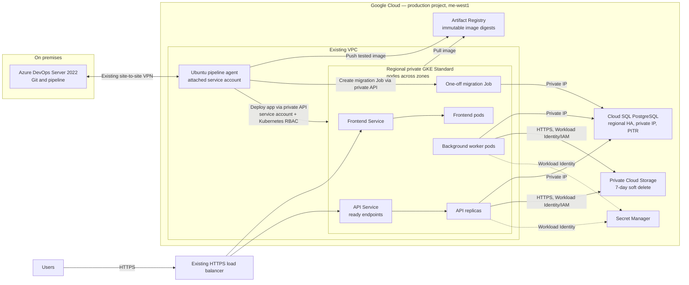

# Corrected system architecture

Proposed target design; not deployed. Managed services are shown outside the VPC boundary.

## Box legend

| Diagram box | What it does |
|---|---|
| Users | Submit survey files and use the service. |
| HTTPS load balancer | Existing public HTTPS entry point; routes requests to frontend and API Services. |
| Azure DevOps Server | On-premises Git repository and CI/CD pipeline. |
| Ubuntu pipeline agent | Runs pipeline jobs; uses its attached service account to push images and deploy through the private GKE API. No key file is used. |
| Regional private GKE Standard | Runs application workloads on nodes distributed across zones; the private API is reachable by the agent over the existing VPN. |
| Frontend Service / pods | Routes user-facing web traffic to ready frontend pods. |
| API Service / replicas | Routes API traffic to ready API pods; replicas spread across nodes/zones for availability. |
| Background worker pods | Process submitted survey work, reading/writing files in Cloud Storage and metadata/status in Cloud SQL. |
| One-off migration Job | Created by the pipeline agent in GKE to run a database schema migration against Cloud SQL during a release. |
| Artifact Registry | Stores versioned container images; deployment uses the recorded image digest. |
| Cloud SQL PostgreSQL | Stores survey records and object references; private IP and regional HA support connectivity and zone resilience. PITR is for database recovery. |
| Private Cloud Storage | Stores uploaded files and reports; applications access it using authenticated API calls. Soft delete supports recovery of deleted objects. |
| Secret Manager | Stores application secrets, accessed by workloads using Workload Identity. |

Cloud SQL and Cloud Storage are Google-managed services outside the VPC boundary. Cloud SQL is reached over private IP; Cloud Storage is accessed through authenticated API calls.

Regional GKE capacity and Cloud SQL HA target a single-zone failure. PITR and bucket soft delete address recovery, not availability. All have cost/quota implications; regional disaster recovery is out of scope.
